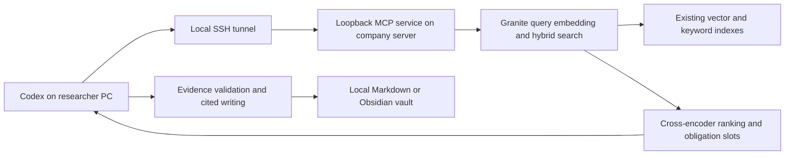

# GIIS Codex RAG

Connect an **existing GIIS hybrid vector index** to locally installed Codex. Researchers use their preferred supported Codex model to retrieve corpus passages, validate evidence against question obligations, and write cited reports in a local folder or Obsidian vault.

This is a spin-off of [LLM for Academic Research](https://github.com/Prience91/LLM-for-Academic-Research). It contains the connection and research-writing workflow only. Index construction, PDF parsing, metadata adjudication, embedding production, synthetic training data and fine-tuning remain outside this repository. No corpus, database, model weights or company credentials are included.



## A teammate's starting point

The company operator supplies a reachable server address and authorized Linux SSH credentials and keeps the existing MCP service running. An ordinary SSH login does not itself forward the MCP port.

Before starting, confirm the operator says the retrieval service is available. A researcher needs Codex, an OpenSSH client, access to the company network and the company SSH credentials. No vector-index download, model download or server installation is needed on the researcher's PC. If the repository is private, obtain repository access or the two starter documents from the operator.

1. Download this repository. Copy **`workspace-template/AGENTS.md`** and **`workspace-template/MCP_instruction.md`** into your local writing folder.
2. Create a local Codex project with that writing folder as **primary**. Attaching the server's shared folder is optional; research uses MCP.
3. Open a chat in that project and ask:

   > Follow MCP_instruction.md to connect my Codex to GIIS RAG. The administrator will supply the company server address and SSH username. Preserve my existing Codex settings and test the live connection before declaring success.

4. Codex can configure the client after your explicit request. If password authentication is needed, enter the password privately in a local terminal; never paste it into chat. Restart Codex after configuration if needed.
5. Ask a research question. The agent follows the obligation–evidence workflow and writes APA-cited outputs in your local workspace.

For a manual tunnel, run the supplied helper on **your PC**:

```powershell
./client/Connect-GiisRag.ps1 -ServerHost 'HOST_FROM_ADMIN' -SshUser 'USER_FROM_ADMIN'
```

Keep the tunnel window open. Add the settings from [client/config.example.toml](client/config.example.toml) to the appropriate Codex configuration, merging existing settings instead of replacing the file. On standard Windows installations the user-level file is `%USERPROFILE%\.codex\config.toml`; a custom Codex home or trusted project scope may change its location. New chats reuse the configuration while the tunnel and server remain running.

After the tunnel opens, [client/Test-GiisMcp.ps1](client/Test-GiisMcp.ps1) verifies the MCP handshake and three expected tools. `-Query` also tests live preliminary retrieval. It does not certify semantic answer completeness.

## First-use and reconnection check

For a teammate onboarding test, close only **your PC's tunnel and Codex**, then follow the steps above. Leave the operator's server service running. Closing a foreground service terminal stops retrieval for everyone; restoring it is an operator task.

If you see a connection failure, follow [the recovery guide](docs/RECOVERY.md). It separates company SSH login, server port 8765 and the PC tunnel on port 18765. After reconnecting, use the existing Codex configuration rather than adding it again. The optional [window launcher](client/Open-GiisTunnel.ps1) opens a visible terminal for private password entry; it is not an automatic password login.

## For the server operator

The deployed service needs a compatible, already-built index package and Granite query embedding model. Researchers do **not** run installation scripts on the company server.

See [existing-index contract](docs/INDEX_CONTRACT.md) and [operator deployment](docs/DEPLOYMENT.md). Put `server/` inside the dedicated data package folder. Install and run from that folder only:

```bash
bash /path/to/GIIS_RAG/server/bootstrap.sh
bash /path/to/GIIS_RAG/server/start.sh
```

The service listens on **127.0.0.1:8765/mcp**. SSH carries the connection to each researcher's own localhost port **18765**. This release has no OAuth service or unauthenticated LAN listener. It runs one retrieval process with serialized model work. Client setup does not authorize server changes. An operator may opt into `server/start-detached.sh` to survive SSH logout with a folder-contained tmux socket. See [connection recovery](docs/RECOVERY.md) before switching a running foreground instance.

## Research protocol

1. Preserve every explicit question clause and search preliminary evidence.
2. Plan distinct evidence-backed atomic obligations, normally 3–10 for substantive questions.
3. Retrieve per obligation; reserve candidate evidence before general fill.
4. Client independently checks whether exact passages support each obligation. Search scores and reserved slots are not semantic coverage.
5. If needed, make one doubled-depth rescue and revalidate the frozen packet.
6. Draft from supported passages; explicitly state residual gaps.
7. Check obligation completion and citations; correct a repairable draft once.
8. Deliver the report with a coverage record and APA 7 reference list matching its in-text citations.

Read [the full protocol](docs/OBLIGATION_EVIDENCE_PROTOCOL.md). The client performs semantic planning and judgment; the server performs embedding, hybrid search, ranking and bounded selection. Model choice can affect those judgments, and instructions do not guarantee every model will apply them correctly.

## Validation and current limits

The founding deployment's CPU smoke test accessed **1,419,435 chunks**, returned 9 passages, and used **3.67 GiB peak process memory**, with initialization plus the query taking **15.6 seconds**. Live Codex testing also exercised obligation retrieval and exact passage fetching. These are observations from one deployment, not a benchmark of arbitrary indexes or many concurrent users.

See [validation record](docs/VALIDATION.md). Repository tests use small synthetic fixtures and require no models or corpus:

```bash
python -B -m unittest discover -s tests -v
```

The 6,144-token evidence allowance uses a disclosed `o200k_base` estimate, not the exact tokenizer for every Codex model. The keyword DB is opened read-only; Chroma may write local bookkeeping. The server supplies candidate mappings, not a semantic approval gate. Reboot/crash supervision and broader multi-user load testing remain operator work.

## Files to reuse

| Path | Purpose |
| --- | --- |
| `workspace-template/AGENTS.md` | Portable research, local writing, Obsidian and APA policy |
| `workspace-template/MCP_instruction.md` | Explicitly invoked client setup manual for Codex |
| `client/Connect-GiisRag.ps1` | Interactive SSH tunnel helper; no password storage |
| `client/Open-GiisTunnel.ps1` | Open a dedicated visible tunnel window for private password entry |
| `client/Configure-Codex.ps1` | Register the URL with an existing Codex CLI, preserving configuration |
| `client/Test-GiisMcp.ps1` | Live protocol/tool/retrieval checks |
| `client/config.example.toml` | Mergeable Codex MCP settings |
| `server/` | Folder-contained Python retriever and loopback MCP service |
| `server/start-detached.sh` and `server/status.sh` | Opt-in tmux operation and read-only server status |
| `docs/` | Protocol, existing-index contract, deployment and validation |

Connection reference: [Codex MCP documentation](https://learn.chatgpt.com/docs/extend/mcp?surface=cli). Transport reference: [MCP Python SDK v1](https://github.com/modelcontextprotocol/python-sdk/tree/v1.x). SSH reference: [OpenSSH manual](https://man.openbsd.org/ssh).
